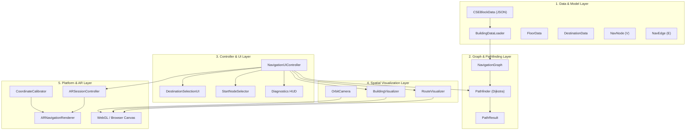
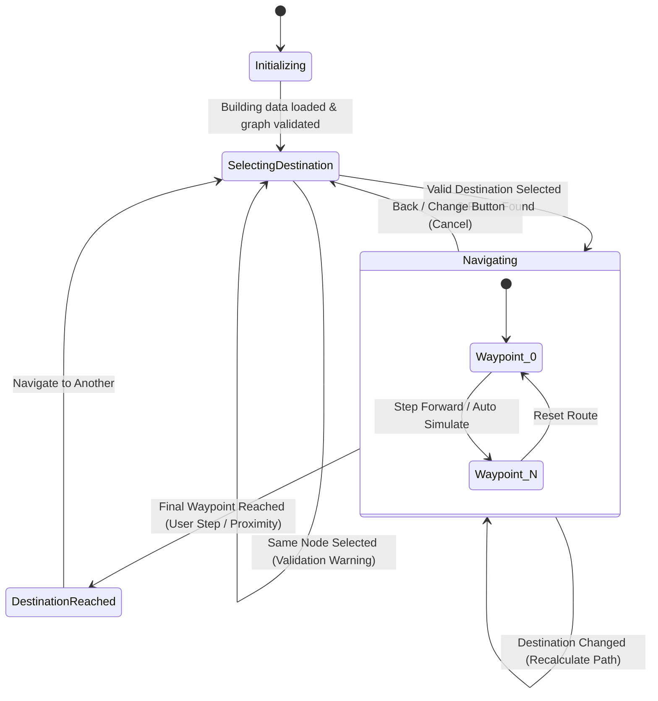

# 3. System Architecture & Design

## 1. System Overview

The **SmartClassroomAR** architecture follows a modular, decoupled 5-tier design pattern combining graph data models, deterministic pathfinding algorithms, high-performance 3D procedural rendering, reactive uGUI interface management, and hardware-abstracted AR tracking.

---

## 2. Layer Breakdown

### 1. Data & Model Layer (`SmartClassroomAR.Mapping`)
- **`CSEBlockData`**: Static repository containing the JSON specification for the Sathyabama CSE building. Represents 3 floors, 15+ destination facilities, 30+ navigation nodes, and interconnecting edges.
- **`BuildingDataLoader`**: High-performance JSON parser compatible with Unity's `JsonUtility`. Enforces strict relational validation (e.g., verifying that every destination references a valid node ID, and every edge references existent source and destination nodes).
- **`FloorData` & `DestinationData`**: Data transfer objects defining semantic categories (Classroom, Laboratory, FacultyRoom, Entrance, Staircase, Corridor).

### 2. Graph & Pathfinding Layer (`SmartClassroomAR.Navigation`)
- **`NavigationGraph`**: In-memory adjacency representation storing nodes in a hash map `Dictionary<string, NavNode>` and bidirectional edges in `List<NavEdge>`. Provides graph validation routines checking for disconnected subgraphs or non-positive edge weights.
- **`Pathfinder`**: Implementation of Dijkstra's algorithm utilizing a sorted priority queue. Computes the optimal path, accumulates metric distance costs, detects multi-floor staircase crossings, and returns an immutable `PathResult`.

### 3. Controller & UI Layer (`SmartClassroomAR.UI`)
- **`NavigationUIController`**: Central coordinator orchestrating application state transitions, user input events, pathfinding requests, and visualizer synchronizations.
- **`DestinationSelectionUI`**: Manages the left-hand directory panel, floor accordions, real-time search filtering, dynamic button instantiation, and programmatic selection API.
- **`StartNodeSelector`**: Manages the starting entrance/staircase dropdown selector.
- **Diagnostics Overlay**: Real-time HUD displaying system state, active node IDs, route length, and active panel names for verification and debugging.

### 4. Spatial Visualization Layer (`SmartClassroomAR.Visualization`)
- **`BuildingVisualizer`**: Procedurally generates the 3D building model (floor plates, corridors, wall balustrades, room volumes, stair flight ramps, and billboarded TextMeshPro 3D room labels) at runtime. Supports floor highlighting and transparency switching.
- **`RouteVisualizer`**: Dynamically creates the 3D route polyline using Unity `LineRenderer`. Renders glowing start/destination markers, staircase transition glyphs, and the animated user avatar beacon. Manages completed (green) vs remaining (cyan) segment rendering.
- **`OrbitCamera`**: Cinematic camera controller with smooth mouse orbit (left-click), pan (Alt + left-click or middle-click), zoom (mouse wheel), keyboard floor focusing (Keys 1, 2, 3), and view reset ('R').

### 5. Platform & AR Layer (`SmartClassroomAR.AR`)
- **`ARSessionController`**: Interfaces with AR Foundation (`ARSession`, `ARSessionOrigin`). In WebGL and Editor builds, seamlessly activates Demo Navigation Mode without delaying for mobile AR hardware.
- **`ARNavigationRenderer`**: Instantiates camera-space 3D navigation chevrons, waypoint beacons, and proximity triggers for mobile AR deployment.
- **`CoordinateCalibrator`**: Translates digital building coordinates into physical AR tracking space via affine transformation matrices derived from measured physical anchor points.

---

## 3. UI State Machine Specification

The navigation lifecycle follows a deterministic finite state machine (FSM) implemented in `NavigationUIController`:

### State Definitions:
1. **`Initializing`**:
   - Building JSON is parsed and cross-referenced.
   - 3D Building geometry is constructed by `BuildingVisualizer`.
   - UI dropdowns and destination lists are populated.
   - Transitions immediately to `SelectingDestination`.
2. **`SelectingDestination`**:
   - Left-hand sidebar is active (`DestinationSelectionPanel`).
   - 3D building displays full architectural model with billboard labels.
   - User selects starting location (default: Main Entrance) and browses destinations.
3. **`Navigating`**:
   - Navigation panel (`demoNavigationPanel`) is activated.
   - 3D route is generated and highlighted by `RouteVisualizer`.
   - Destination title, floor indicator, and total distance are displayed.
   - Controls available: **Step Forward**, **Auto Simulate**, **Reset Route**, **Back / Change**.
4. **`DestinationReached`**:
   - Arrival card (`destinationReachedPanel`) is displayed.
   - Confirms destination arrival with checkmark and metric details.
   - User can click "Navigate to Another" to return to `SelectingDestination`.
