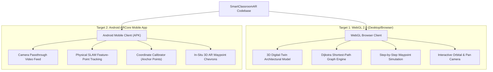

# 6. WebGL Deployment & Augmented Reality Analysis

## 1. Technical Honesty & Platform Architecture

In academic evaluation and professional software engineering, clear technical distinctions between simulation environments and physical hardware sensing are critical. The **SmartClassroomAR** project implements a dual-target architecture:

### Why Desktop WebGL Operates in 3D Simulation Mode
1. **Absence of WebXR AR Depth Sensors in Desktop Browsers:** Standard desktop computers and laptop webcams lack the time-of-flight (ToF) depth sensors, hardware IMU inertial odometry, and plane-detection SLAM pipelines provided by mobile operating systems (Google ARCore / Apple ARKit).
2. **Camera Calibration & Spatial Anchoring:** In an indoor facility, camera-based AR requires aligning virtual coordinates to physical floor markers. A stationary laptop or desktop monitor cannot traverse building hallways as an augmented viewfinder.
3. **The Pedagogical Value of Digital Twins:** Running the 3D building twin in WebGL allows external examiners, evaluators, faculty, and students to access, explore, and verify the navigation system instantly through any web browser without installing specialized mobile APKs or possessing ARCore-certified smartphones.

---

## 2. WebGL Compilation & Optimization Architecture

WebGL compilation transforms Unity C# scripts into high-performance C++ via Unity's **IL2CPP** (Intermediate Language to C++) engine, which is then compiled to **WebAssembly (WASM)** and JavaScript via Emscripten.

### Optimization Matrix:
| Parameter | Setting | Technical Rationale |
| :--- | :--- | :--- |
| **Graphics API** | WebGL 2.0 | Leverages OpenGL ES 3.0 equivalent features for hardware-accelerated instanced rendering and standard shaders. |
| **Code Stripping** | High (Managed Stripping) | Minimizes final WASM binary size from >120MB to ~34.9MB uncompressed (~8.5MB compressed). |
| **Shader Stripping Guard** | `_ShaderKeeper` GameObject | Prevents Unity Editor from stripping essential shaders (`Standard`, `Sprites/Default`, `TextMeshPro`) during build time. |
| **Input System Bridge** | `InputSystemUIInputModule` | Configures default pointer, click, and scroll actions, ensuring button clicks and mouse wheel events operate seamlessly in browser canvases. |
| **Memory Allocation** | 256MB to 512MB Dynamic Heap | Accommodates graph traversal structures, mesh generation buffers, and TextMeshPro glyph caches without Out-Of-Memory (OOM) browser exceptions. |

---

## 3. Physical Android ARCore Architecture

For physical indoor navigation on campus, the system builds to Android (API 28+):
1. **SLAM Tracking (Simultaneous Localization and Mapping):** Google ARCore detects high-contrast visual feature points in the camera feed and fuses them with internal accelerometer and gyroscope readings to compute a 6-Degrees-of-Freedom (6-DoF) device pose.
2. **Coordinate Calibration (`CoordinateCalibrator.cs`):**
   - The digital building coordinate frame must align with the physical environment.
   - At the building entrance, two known physical reference markers are surveyed:
     - Anchor 1: Building Entrance Portal ($X = -3.0, Y = 0.0, Z = 0.0$)
     - Anchor 2: Ground Floor Corridor Junction ($X = 12.5, Y = 0.0, Z = 0.0$)
   - A rigid affine transformation matrix $[R | T]$ maps digital coordinates into AR camera space:
     $$\mathbf{P}_{\text{AR}} = \mathbf{R} \cdot \mathbf{P}_{\text{Building}} + \mathbf{T}$$
3. **In-Situ Visual Waypoints (`ARNavigationRenderer.cs`):**
   - Floating green 3D directional chevrons point along the path vectors.
   - A pulsing red spatial beacon hovers over the physical destination doorway.
   - Distance threshold triggers ($< 2.0\text{m}$) automatically declare destination arrival.
